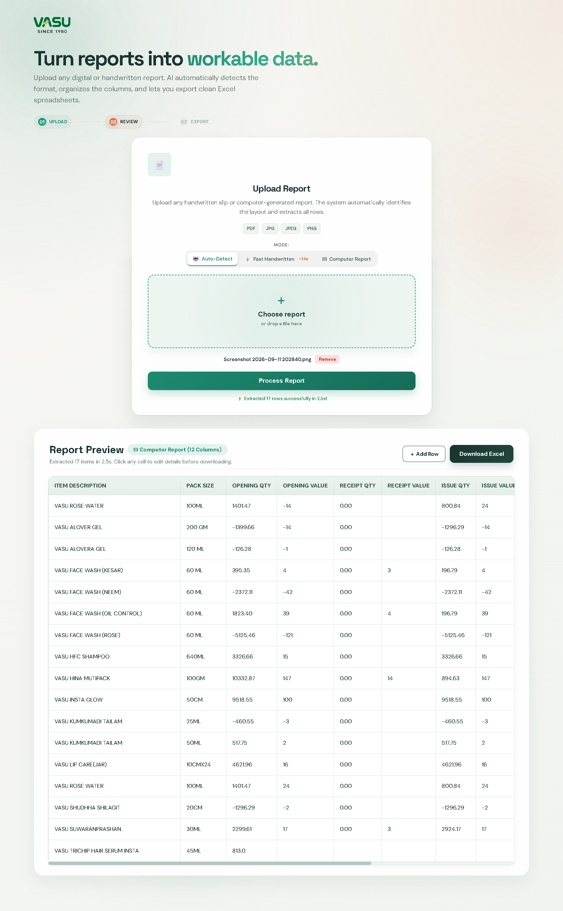

<p align="center">
  
</p>

<h1 align="center">Report2Excel</h1>

<p align="center">
  Turn computer-generated and handwritten report sheets into clean, formatted Excel files.
</p>

---

## Overview

Report2Excel is a web app that converts **report sheets (single-page PDFs and images) into formatted Excel spreadsheets (`.xlsx`)**. It uses a Vision AI API to read the report, verifies document validity, lets you review and edit rows inline, and exports a ready-to-use Excel file.

> **Note:** This tool was built for specific report layouts used at Vasu Healthcare. The Vasu name and logo belong to their owner and are shown here only to identify the report format it was built for. No company data is included in this repository.

## Screenshots

| Upload | Review and Edit |
| :---: | :---: |
|  |  |

*Screenshots use dummy data.*

---

## Features

- **Fast & Lean Vision Extraction:** Images are resized and compressed with Sharp before upload, so extraction takes about 1.5 to 4 seconds.
- **Strict Document Verification:** Rejects non-report uploads (e.g. selfies, random photos, unrelated documents) with helpful guidance.
- **Enforced Single-Page Rule:** Enforces 1 single document / 1 single page per upload to protect token quota and ensure high extraction accuracy.
- **Three Processing Modes:**
  - **Auto-Detect (default):** Identifies the report layout by itself.
  - **Fast Handwritten:** Built for notebook pages and handwritten slips. It solves written sums (`96+36=142` becomes `142`), resolves ditto marks (`"`), and cleans unit labels.
  - **Computer Report:** Extracts 12-column stock and inventory reports.
- **Interactive Review & Edit:** Click any cell to fix details, add new rows, or delete unwanted rows.
- **Live Search & Filter:** Instantly filter table items in real time as you type.
- **Clipboard Export:** One-click "📋 Copy Data" (TSV) to paste directly into Google Sheets or Excel without downloading files.
- **Summary Metrics Bar:** Dynamic real-time calculation of total rows and sum of quantities.
- **Dark & Light Mode:** Seamless theme toggle with local storage persistence and branded logo adaptation.
- **Responsive Design:** Optimized layout across all devices, from ultra-wide desktops down to 360px mobile screens.
- **Excel Export:**
  - Dark emerald header with white bold text
  - Auto-fitted column widths
  - Number formatting (`#,##0`) for quantities
  - Automatic `TOTAL` summary row
  - Clean hairline borders, ready for printing

## Supported Report Formats

| | Handwritten Slip | Computer-Generated Report |
| :--- | :--- | :--- |
| **Typical source** | Notebook pages, handwritten slips | Printed or PDF stock sheets |
| **Columns** | `SR.NO`, `ITEM NAME`, `PACK SIZE`, `QUANTITY` | `ITEM DESCRIPTION`, `PACK SIZE`, `OPENING QTY/VALUE`, `RECEIPT QTY/VALUE`, `ISSUE QTY/VALUE`, `CLOSING QTY/VALUE`, `DUMP QTY`, `M.EXP` |
| **Math solver** | Yes | Not needed |
| **Average speed** | ~1.5 to 2.5 s | ~2.5 to 4.5 s |
| **Needs API key** | Yes | Yes |

---

## Tech Stack

- **Backend:** Node.js, Express
- **AI Engine:** Groq Cloud Vision AI (`qwen/qwen3.8-27b`) / xAI (`grok-2-vision-1212`)
- **Image & PDF handling:** Sharp, pdf-lib, pdf-parse
- **Excel generation:** ExcelJS
- **Frontend:** Vanilla HTML5, CSS3, JavaScript (zero heavy frameworks)

---

## Getting Started

### 1. Prerequisites
Node.js 18 or newer.

### 2. Install
```bash
git clone https://github.com/iamaadii/Report2Excel.git
cd Report2Excel/sourceCode
npm install
```

### 3. Configure
Create a `.env` file inside `sourceCode`:
```env
# Primary Vision API Key (Groq or xAI)
GROK_API_KEY=gsk_your_groq_api_key_here

# Optional: Multi-key fallback rotation (comma-separated)
GROQ_API_KEYS=gsk_key1,gsk_key2
```
Never commit this file. It is listed in `.gitignore`.

### 4. Run
```bash
npm run dev     # development with auto-reload
npm start       # production
```

### 5. Open
```text
http://localhost:5000
```

---

## How to Use

1. **Pick a mode:** Auto-Detect, Fast Handwritten, or Computer Report.
2. **Upload** a single-page PDF, JPG, JPEG, or PNG.
3. Click **Process Report**.
4. **Review & Filter** the extracted table. Edit cells inline or add/delete rows as needed.
5. Click **Download Excel** or **Copy Data** to use your spreadsheet.

---

## Project Structure

```text
Report2Excel/
├── README.md
├── docs/
│   ├── ARCHITECTURE.md
│   ├── logo-card.png
│   └── screenshots/
├── sourceCode/
│   ├── server.js                        # Express server entry point
│   ├── controllers/
│   │   └── reportController.js          # Request handling, page validation, export
│   ├── middleware/
│   │   └── uploadMiddleware.js          # Multer upload configuration & filters
│   ├── public/                          # Frontend assets
│   │   ├── index.html                   # Responsive UI & theme toggle
│   │   ├── style.css                    # Glassmorphism, animations & dark mode
│   │   ├── script.js                    # Dynamic DOM, live search, clipboard & export
│   │   ├── favicon.svg
│   │   └── logo.png
│   ├── routes/
│   │   └── reportRoutes.js              # API routes (/process, /download)
│   ├── services/
│   │   ├── reportExtractionService.js   # Vision AI prompt routing, multi-key rotation
│   │   ├── pdfService.js                # PDF page extraction & count validation
│   │   ├── excelService.js              # Branded .xlsx generator
│   │   └── tempStorage.js               # Temporary directory resolver
│   ├── uploads/                         # Temporary upload staging (auto-cleaned)
│   └── package.json
└── vercel.json
```

---

## License

For portfolio and demonstration purposes.